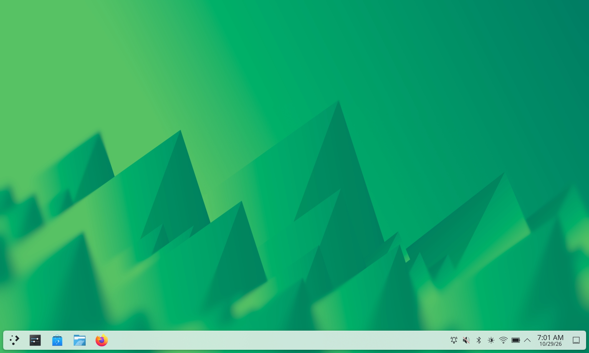
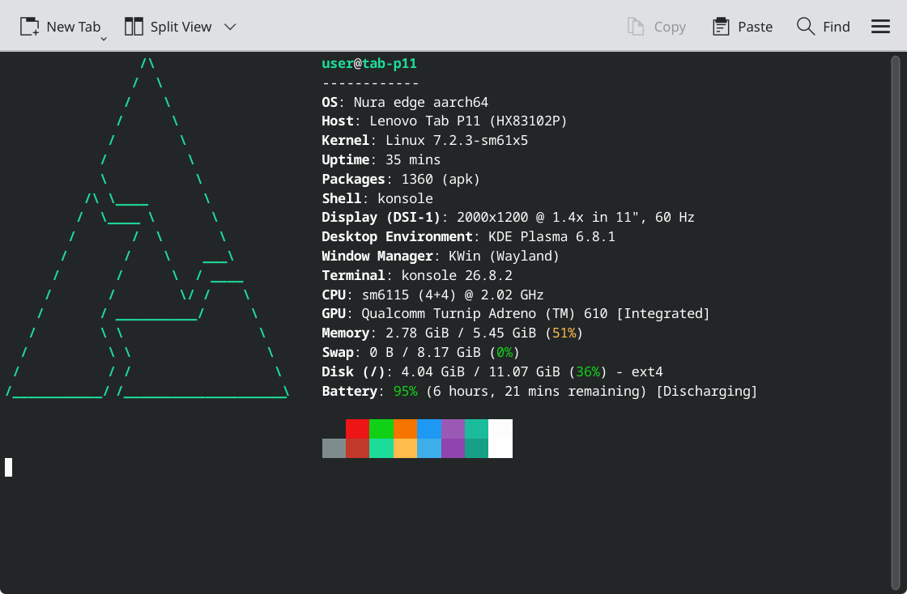
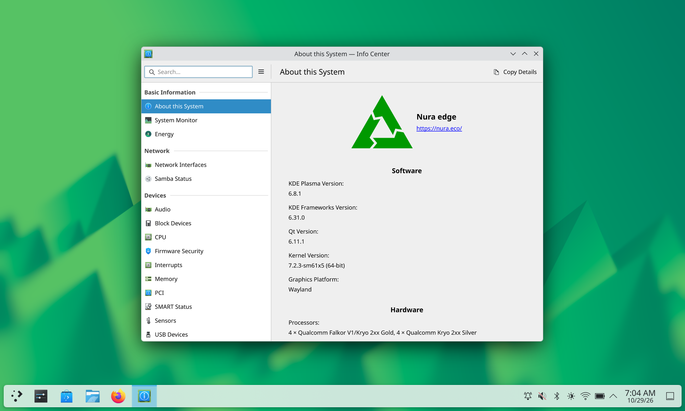

# postmarketOS для Lenovo Tab P11 (TB-J606F)

Порт [postmarketOS](https://postmarketos.org) (с 2026 года проект называется **Nura**) на планшет
**Lenovo Tab P11 TB-J606F** (Wi-Fi) на основе **mainline-ядра Linux 7.2**
([linux-nura-qcom-sm61x5](https://codeberg.org/sm61x5-mainline/linux)).

> **Статус: pmOS (Nura edge) с KDE Plasma Desktop ставится во внутреннюю память и грузится сам.** Работают дисплей, GPU (OpenGL ES и Vulkan),
> Plasma (Wayland), Wi-Fi, **Bluetooth (полностью: сопряжение и устройства ввода)**, USB-сеть/SSH, кнопки, батарея и статус зарядки.
> Работают датчики (свет, приближение, акселерометр), **тачскрин** (порт GPL-драйвера Lenovo для HX83102E), **USB OTG** и зарядка от сетевой USB-C,
> GPU после исправления голосования за память DDR (патч 0009) быстрее в 2.5–7 раз. Звука, сна и офлайн-зарядки пока нет.
> Обновления ставятся через **apk-репозиторий** (см. [ниже](#обновления-через-apk-репозиторий)). Подробности — в [STATE.md](STATE.md).

**Автор порта и apk-репозитория — [@nnshould](https://t.me/nnshould) (Telegram).** Вопросы по репозиторию, установке и помощь — туда.



<details>
<summary>Ещё скриншоты</summary>

| fastfetch | Информация о системе (KInfoCenter) |
|---|---|
|  |  |

Ранний этап bring-up — weston на mainline-ядре (снимок буфера композитора):


</details>

---

## Содержание
- [Устройство](#устройство)
- [Что работает](#что-работает)
- [Главная особенность: загрузчик Lenovo и dtbo](#главная-особенность-загрузчик-lenovo-и-dtbo)
- [Структура репозитория](#структура-репозитория)
- [Сборка](#сборка)
- [Установка](#установка)
- [Обновления через apk-репозиторий](#обновления-через-apk-репозиторий)
- [Откат на Android](#откат-на-android)
- [Отладочная среда без rootfs](#отладочная-среда-без-rootfs)
- [Известные проблемы и планы](#известные-проблемы-и-планы)
- [Благодарности и лицензии](#благодарности-и-лицензии)

## Устройство

| | |
|---|---|
| Модель | Lenovo Tab P11, TB-J606F (Wi-Fi, без LTE), 2020 |
| SoC | Qualcomm SM6115P «bengalp» (Snapdragon 662), soc_id 445 |
| CPU | 4× Kryo 260 Gold до 2.016 ГГц + 4× Kryo 260 Silver до 1.8 ГГц |
| GPU | Adreno 610 |
| RAM / память | 4 или 6 ГБ / UFS 64 или 128 ГБ (проверено на 6/128) |
| Экран | 11", 2000×1200, **две ревизии**: BOE + **Himax HX83102P** (основная, проверена) и BOE + Novatek NT36523W (свой DTB и device-пакет, не проверено) |
| Тач | Himax HX83102E (zero-flash, SPI) + стилус; у второй ревизии Novatek |
| Wi-Fi / BT | WCN3990 (ath10k_snoc / btqca) |
| Батарея | 7500 мА·ч, fuel gauge MM8013, зарядник PMI632 + SMB1355 |
| Звук | 4× Awinic AW88258, ES7210, WCD937x / PM2250 |
| Датчики | через Qualcomm SSC (ADSP): ICM4x6xx, LTR578, TMF8801, SX932x |

Ревизия определяется по `/proc/cmdline` стокового Android:
`msm_drm.dsi_display0=qcom,mdss_dsi_himax83102p_boe_2k_video` означает ревизию Himax (этот порт).

## Что работает

Проверено в установленном pmOS (ядро 7.2.3 с патчами до 0009, Plasma Desktop), сначала — через `fastboot boot`. Доказательства (команды и вывод) в [WORKLOG.md](WORKLOG.md).

| Подсистема | Статус | Примечание |
|---|---|---|
| Загрузка ядра | ✅ | со стёртым `dtbo` (или через «отстойник» для стокового dtbo, см. ниже) |
| UFS, разметка | ✅ | |
| Дисплей HX83102P + подсветка | ✅ | свой драйвер панели (init из стокового DT), 60 Гц, DCS-яркость 0…4095 |
| GPU Adreno 610 | ✅ | Mesa freedreno (GLES 3.2) и **Vulkan** через turnip (`mesa-vulkan-freedreno`). Патч 0009: GPU голосует за пропускную способность DDR (в sm6115.dtsi её не было) — glmark2-es2 277 → 694, vkmark 87 → 599 |
| Wayland, KDE Plasma Desktop | ✅ | weston и Plasma (kwin_wayland) на GPU, 60 Гц; автологин и ландшафт настраиваются вручную |
| Экранная клавиатура | ✅ | plasma-keyboard (EN/RU), значок на панели; см. [NOTES.md](NOTES.md) п. 39 |
| Кнопки Power, Vol± | ✅ | Power гасит/включает экран (настройка PowerDevil) |
| USB-сеть, SSH | ✅ | гаджет ECM/ACM |
| USB OTG (хост) | ✅ | Type-C через FUSB302 + внешний 5 В буст (gpio38), патч 0008; USB 2.0, без PD. Проверено с USB-ресивером мыши. После выхода из режима хоста USB-сеть к ПК не работает до перезагрузки (dwc3 «failed to enable ep0out») |
| Зарядка от сетевой USB-C (C-to-C) | ✅ | FUSB302 выставляет Rd, зарядка даёт 5 В / до 3 А (без PD); в батарею ~1.4 А. Без патча 0008 C-to-C-зарядки не включаются |
| Wi-Fi | ✅ | ath10k (WCN3990): подключение WPA2, DHCP, интернет |
| Bluetooth | ✅ полностью | WCN3990 (btqca): поиск, сопряжение, HID-устройства (проверено с мышью); постоянный адрес задаёт bootmac |
| Батарея | ✅ | fuel gauge mm8013 (патч 0005: правильный знак тока по ABI, связь с зарядником, Li-ion) — Plasma/UPower показывают заряд/разряд верно |
| cpufreq, thermal, троттлинг CPU | ✅ | cooling-maps добавлены в DTS |
| Modem / ADSP / CDSP | ✅ стартуют | стоковые прошивки |
| Перезагрузка в bootloader | ✅ | reboot-mode PON |
| Тачскрин | ✅ | HX83102E (zero-flash, SPI): порт драйвера Lenovo (патч 0006), прошивка `Himax_firmware.bin` со своего устройства; следует за панелью при гашении экрана |
| Стилус | ❓ | устройство `himax-pen` есть, с пером не проверено |
| Звук | ❌ | нет драйверов AW88258, ES7210 |
| Датчики (акселерометр, свет, приближение) | ✅ | Qualcomm SSC на ADSP: hexagonrpcd (свой патч, `pmaports/temp/hexagonrpcd`) + libssc + iio-sensor-proxy; файлы SSC — со своего устройства. Матрица ориентации акселерометра ещё не подобрана |
| Зарядник PMI632 | ⚠️ только статус | свой read-only драйвер (патч 0004): онлайн, статус, тип USB, лимиты; заряд на настройках загрузчика (4.40 В / 3 А). SMB1355 нет |
| Сон (s2idle) | ❌ | засыпает, но: dwc3 после сна не поднимает ep0 (USB-сеть до перезагрузки), ADSP падает и будит через ~2 с. Автосон PowerDevil лучше выключить. [NOTES](NOTES.md) п. 48 |
| Офлайн-зарядка | ❌ | загрузчик при зарядке выключенного планшета запускает систему полностью (androidboot.mode=charger в initramfs pmOS не обрабатывается) |
| Камеры, клавиатура на pogo-пинах | ❓ | не проверялось |

## Главная особенность: загрузчик Lenovo и dtbo

ABL этого планшета **всегда** накладывает оверлей из раздела `dtbo` (запись «Lenovo P11 WIFI PVT») на DTB из boot.img.
В mainline DTB нет `__symbols__`, наложение не удаётся, и ABL отвечает `Booting OKAY`, но ядро не запускает.

**Простое решение (проверено): стереть dtbo слота, с которого грузится pmOS** — `fastboot erase dtbo_b`.
Тогда ABL берёт DTB из boot.img как есть (подсказал коллега, тоже портирующий pmOS на этот планшет). Стоковый `dtbo_a` при этом не трогается.

Решение без записи в `dtbo` (если стирать нельзя):
[`kernel/dts/sm6115p-lenovo-j606f-abl-sink.dtsi`](kernel/dts/sm6115p-lenovo-j606f-abl-sink.dtsi) добавляет выключенный узел `/abl-sink`
с узлом-phandle на каждую метку из `__fixups__` стокового оверлея (138 штук) и `__symbols__`, которые указывают на эти узлы.
Оверлей ложится в «отстойник», ядро его не трогает. Генератор: [`scripts/gen_abl_sink_dtsi.py`](scripts/gen_abl_sink_dtsi.py).

Побочный эффект: ABL заменяет корневые `model`/`compatible` на `qcom,bengalp-idp`. Из-за этого `ubwc_config` и `qcom_pd_mapper`
не узнают SoC. Это обходил патч `0002-HACK` (добавляет `qcom,bengalp`; лежит в `kernel/patches/` для этого случая).
**Сейчас используется стёртый dtbo_b**, поэтому пакет ядра собирается **без** HACK 0002, а abl-sink остаётся в DTB как страховка.

Ещё одна особенность: `fastboot boot` работает **один раз за сессию bootloader**. Перед каждой попыткой нужен `fastboot reboot bootloader`.

## Структура репозитория

```
kernel/
  patches/                 патчи к linux-nura-qcom-sm61x5 7.2.3
    0001-…-HX83102P.patch   панель BOE/Himax HX83102P в panel-himax-hx83102.c
    0002-HACK-…patch        qcom,bengalp для ubwc_config/pd_mapper (только если dtbo не стёрт; в пакет не входит)
    0003-…-HX83102P-SKU.patch  DTS ревизии HX83102P + abl-sink.dtsi + Makefile
    0004-…-PMI632-charger…patch  read-only драйвер зарядника PMI632 (SMB5) + узел в DTS
    0005-…-mm8013-…patch      mm8013: знак current_now, power-supplies → зарядник, TECHNOLOGY=Li-ion
    0006-…-HX83102E-…patch    тачскрин Himax HX83102E (порт драйвера Lenovo) + узел в DTS
    0007-…-NT36523W-SKU.patch общая часть DTS (common.dtsi) + DTB ревизии NT36523W
    0008-…-USB-C-OTG…patch     USB-C OTG: FUSB302 (I2C0 0x22) + VBUS-буст по gpio38, dwc3 dual-role
    0009-…-GPU-DDR-bandwidth…  голосование GPU за пропускную способность DDR (gfx-mem + opp-peak-kBps из стока)
    config-j606f.fragment   опции ядра (HX83102, TPS65132, MM8013, NT36523, CHARGER_QCOM_PMI632, TOUCHSCREEN_HIMAX_HX83102E, TYPEC_FUSB302)
  himax83102p-port/         как получен 0006: port.py (исходники Lenovo → 7.2), make_patch.sh, Kconfig/Makefile
  dts/                     те же DTS отдельными файлами
pmaports/device/testing/
  linux-nura-qcom-sm61x5/  пакет ядра 7.2.3 с патчами 0001, 0003–0009 (pkgrel 109)
  device-lenovo-j606f-nt36523w/  device-пакет ревизии NT36523W (не проверен)
  device-lenovo-j606f/     device-пакет (deviceinfo: rootfs → userdata, автозапись boot_b при обновлении; modules-initfs, прошивка GPU в initramfs, bootmac)
  firmware-lenovo-j606f/   firmware-пакет (APKBUILD; блобы вы извлекаете со своего устройства)
pmaports/temp/hexagonrpcd/ hexagonrpcd 0.4.0-r50 с патчем: отдаёт ADSP файл sns_reg_version (нужно для датчиков SSC)
scripts/                   инструменты: разбор boot.img/dtbo/super, бэкап, отладочный initramfs,
                           сборка на самом планшете, прокси для USB-сети, установка
STATE.md                   ← НАЧАТЬ ЗДЕСЬ: текущее состояние, пути, версии, следующий шаг
WORKLOG.md                 полная хронология (команды, вывод, ошибки, тупики)
DEVICE.md                  всё про планшет: железо, разделы, режимы загрузки, статус
NOTES.md                   решения, грабли, команды, ссылки, TODO
docs/
  DECISIONS.md             принятые решения и почему (подробно)
  COMMANDS.md              проверенные команды
  notes/                   заметки по подсистемам (display, touch, wifi_bt, power, audio, sensors, boot …)
```

> **Чего здесь нет и не будет:** дампов разделов, прошивок Lenovo, серийных номеров, MAC-адресов, ключей и паролей.
> Прошивки извлекаются с **вашего** устройства (см. ниже).

## Сборка

### 1. Прошивки со своего устройства
Нужен root (Magisk) в стоковом Android:
```bash
bash scripts/phase0_root.sh                 # сбор сведений
bash scripts/backup_partitions.sh           # полный бэкап, sha256 сверяется
# прошивки: /vendor/firmware_mnt (modem_a), /vendor/firmware, /vendor/bt_firmware
python3 -I scripts/pil_squash.py adsp.mbn  image/adsp.mdt      # .mdt + .bNN → .mbn
python3 -I scripts/pil_squash.py cdsp.mbn  image/cdsp.mdt
python3 -I scripts/pil_squash.py modem.mbn image/modem.mdt
python3 -I scripts/pil_squash.py a610_zap.mbn a610_zap.mdt
```
Из них собирается `firmware-lenovo-j606f-1.tar` (раскладка в APKBUILD пакета):
`qcom/sm6115/LENOVO/J606F/{a610_zap,adsp,cdsp,modem,wlanmdsp}.mbn`, `qca/{crbtfw21.tlv,crnv21.bin}`,
`Himax_firmware.bin` и `Himax_mpfw.bin` (тач, из `/vendor/firmware`).

### 2. pmaports
```bash
git clone https://gitlab.postmarketos.org/postmarketOS/pmaports.git
cp -r pmaports/device/testing/device-lenovo-j606f    <pmaports>/device/testing/
cp -r pmaports/device/testing/firmware-lenovo-j606f  <pmaports>/device/testing/
cp -r pmaports/device/testing/linux-nura-qcom-sm61x5 <pmaports>/device/testing/   # ядро 7.2.3 + патчи 0001, 0003–0009 (pkgrel 109)
cp -r pmaports/temp/hexagonrpcd                      <pmaports>/temp/              # для датчиков (см. docs/notes/sensors.md)
cp firmware-lenovo-j606f-1.tar <pmaports>/device/testing/firmware-lenovo-j606f/
pmbootstrap checksum firmware-lenovo-j606f   # тарбол у каждого свой
```
> Пакет ядра здесь — апстримный `linux-nura-qcom-sm61x5` 7.2.3 с добавленными патчами из [`kernel/patches/`](kernel/patches/) и опциями
> из `config-j606f.fragment`. Первая установка делалась иначе: бинарное ядро 7.2.3-r0 + модули/DTB, собранные отдельно
> ([`scripts/device_build_inner.sh`](scripts/device_build_inner.sh)); этот путь описан в [WORKLOG.md](WORKLOG.md).

### 3. pmbootstrap
```bash
pmbootstrap init         # device: lenovo-j606f
pmbootstrap install
pmbootstrap export
```
Проверено на x86_64 Ubuntu 22.04 (ядро собирается cross-native) и **на самом планшете** (aarch64, под mainline, в chroot на userdata,
[`scripts/device_pmb_env.sh`](scripts/device_pmb_env.sh)). Если зеркало медленное, поможет кэширующий прокси
[`scripts/mirror_proxy.py`](scripts/mirror_proxy.py) на соседнем компьютере.

## Установка

> **Ревизия с панелью Novatek NT36523W** (`dsi_display0=…nt36523w…`): отдельный device `lenovo-j606f-nt36523w`,
> инструкция — [`docs/notes/install_nt36523w.md`](docs/notes/install_nt36523w.md) (в железе пока не проверено, тача нет).

Рекомендуемая схема: **rootfs в userdata** (~100 ГиБ), boot.img в **boot_b**, dtbo_b стёрт, слот a не трогаем.
**userdata стирается целиком** (данные Android пропадут).
```bash
fastboot flash userdata lenovo-j606f.img   # rootfs (pmOS_boot + pmOS_root), образ sparse: только fastboot, не dd!
fastboot boot boot.img                     # проверка ядра без записи (fastboot boot — 1 раз за сессию bootloader)
# если загрузилось: снова в fastboot (reboot bootloader из Linux или Vol− + Power), затем
fastboot flash boot_b boot.img             # userdata и boot_b — из одного pmbootstrap install (UUID)
fastboot erase dtbo_b                      # ABL перестаёт накладывать стоковый оверлей
fastboot --set-active=b && fastboot reboot
```
С device-пакетом r6 `pmbootstrap flasher flash_rootfs` сам пишет в userdata (`deviceinfo_flash_fastboot_partition_rootfs="userdata"`).
- **Не держите pmOS-разметку сразу в двух разделах.** initramfs берёт первый раздел с двумя подразделами в порядке
  `/proc/diskstats`, а super (sda14) идёт раньше userdata (sda15). На чистом устройстве в super лежат разделы Android, это не мешает.
  Если раньше ставили pmOS в super, удалите там GPT (NOTES п. 43).
- Этот порт сначала стоял в super и был перенесён в userdata поблочно (NOTES п. 43). Чистую установку сразу в userdata по командам выше
  мы не проверяли: если корень не занял весь раздел, растяните его (`sfdisk`/`resize2fs`, как в п. 43).

Подробно, с откатом: [`docs/notes/install_plan.md`](docs/notes/install_plan.md).
[`scripts/device_install_pmos.sh`](scripts/device_install_pmos.sh) — старый скрипт установки в **super** из запущенного mainline (история).

## Обновления через apk-репозиторий

Собранные пакеты порта (ядро, device-пакеты, hexagonrpcd) лежат в подписанном apk-репозитории
**https://repo.yarnick.ru/j606f** (ключ `pmos@local-6ae27901`). Репозиторий ведёт [@nnshould](https://t.me/nnshould) (Telegram) — по вопросам о нём писать туда. Прошивок Lenovo (`firmware-lenovo-j606f`) там нет и не будет —
это блобы конкретного устройства, их каждый собирает сам.

Подключение (один раз):
```bash
sudo wget -O /etc/apk/keys/pmos@local-6ae27901.rsa.pub https://repo.yarnick.ru/pmos@local-6ae27901.rsa.pub
echo "@j606f https://repo.yarnick.ru/j606f" | sudo tee -a /etc/apk/repositories
sudo apk update
# закрепить пакеты порта за этим репозиторием (иначе более новый апстримный linux-nura-qcom-sm61x5 без патчей j606f может их заменить)
sudo apk add linux-nura-qcom-sm61x5@j606f device-lenovo-j606f@j606f device-lenovo-j606f-nonfree-firmware@j606f
sudo reboot
```
`hexagonrpcd@j606f` ставьте, только если настроены датчики (без drop-in'ов с `-R` ADSP падает в цикле, NOTES п. 42).

Обновление:
```bash
sudo apk update && sudo apk upgrade && sudo reboot
```
С **device-lenovo-j606f r7** включён `deviceinfo_flash_kernel_on_update`: после обновления ядра или initramfs boot-deploy сам пишет
`boot.img` в `boot` + суффикс текущего слота (`boot_b`) — в выводе apk видно `Flashing boot.img to 'boot_b'`. Ручной `dd` больше не нужен
(на device ≤ r6 — нужен: `sudo dd if=/boot/boot.img of=/dev/disk/by-partlabel/boot_b bs=4M conv=fsync`).
Если новое ядро не загрузится или питание пропало во время записи — в fastboot (Vol− + Power) `fastboot flash boot_b <прошлый boot.img>`;
перед обновлением ядра удобно сохранить копию: `sudo head -c $(stat -c %s /boot/boot.img) /dev/disk/by-partlabel/boot_b > ~/boot_b-backup.img`.
Проверка после перезагрузки: `uname -v` показывает `#<pkgrel+1>-nura-qcom-sm61x5` (например, r109 → `#110`), `apk list -I | grep device-lenovo` — r7 или новее.
Если в сети локальный DNS-фильтр, а systemd-resolved пишет `DNSSEC validation failed: no-signature`, помогает
`sudo resolvectl reset-server-features && sudo resolvectl flush-caches` (NOTES п. 50).

Публикация (для сопровождающего): [`scripts/publish_repo.sh`](scripts/publish_repo.sh) — берёт свежие целые пакеты, отсекает
firmware и всё с `license = proprietary`, строит индекс v2 (`apk index` + `abuild-sign`; `apk mkndx` даёт формат adb) и заливает rsync.

## Откат на Android
- Перед любой записью сделайте полный бэкап ([`scripts/backup_partitions.sh`](scripts/backup_partitions.sh)).
- `fastboot --set-active=a` вернёт загрузку со слота a, если он не трогался.
- Полный откат: EDL + [qdl](https://github.com/linux-msm/qdl) и стоковая прошивка Lenovo (см. вики postmarketOS для этого устройства).

## Отладочная среда без rootfs

Для bring-up без установки: [`scripts/make_debug_bootimg.py`](scripts/make_debug_bootimg.py) собирает boot.img
(header v2) из готового ядра, DTB и маленького initramfs на busybox:
- USB-гаджет ECM (сеть) + ACM (`/dev/cu.usbmodem*` на macOS), link-local адрес 169.254.42.1;
- nc-shell на порту 9100 ([`scripts/tcp_run.sh`](scripts/tcp_run.sh)), ACM-shell ([`scripts/acm_run.py`](scripts/acm_run.py));
- страховочный `reboot -f` через 300 с без контакта с хостом;
- `scripts/cycle_boot.sh`: перезагрузка → bootloader → `fastboot boot` → ожидание сети.

## Известные проблемы и планы
- **Тач:** работает (порт драйвера Lenovo из [adazem009/kernel_lenovo_tbj606](https://github.com/adazem009/kernel_lenovo_tbj606), патч 0006). Перо не проверено. [Заметки](docs/notes/touch.md).
- **Звук:** разъём наушников (PM4125/WCD937x, драйверы в ядре есть); для динамиков AW88258 (ID 0x1852) и микрофонов ES7210 GPL-драйверы Lenovo есть в том же репозитории — нужен порт. [Заметки](docs/notes/audio.md).
- **Датчики:** работают; осталось подобрать `ACCEL_MOUNT_MATRIX` для автоповорота и упаковать файлы SSC. [Заметки](docs/notes/sensors.md), NOTES п. 41–42.
- **Хранилище:** корень pmOS в userdata (~100 ГиБ), см. NOTES п. 43.
- **Зарядник:** запись лимитов (ток от сетевого адаптера, JEITA), параллельный SMB1355 — после проверки read-only драйвера.
- **Сон** (dwc3/ADSP, п. 48), **офлайн-зарядка** (свой хук initramfs или `fastboot oem off-mode-charge 0`), клавиатура на pogo-пинах, датчик Холла, вибромотор/светодиод, камеры, заводские MAC из persist (сейчас bootmac генерирует стабильные из serialno).
- **Настройки по умолчанию** (автологин, ландшафт, кнопка Power, экранная клавиатура, drop-in'ы hexagonrpcd) пока сделаны вручную на планшете, в пакеты не перенесены (STATE.md §2).
- **Зеркала:** если mirror.nura.eco медленный, задайте другие (у нас из России быстро работают эти):
  ```bash
  pmbootstrap config mirrors.alpine   http://mirror.yandex.ru/mirrors/alpine/
  pmbootstrap config mirrors.pmaports https://mirror.minlexx.ru/postmarketos/
  pmbootstrap config mirrors.systemd  https://mirror.minlexx.ru/postmarketos/extra-repos/systemd/
  ```
  Официальный список: https://nura.eco/mirrors/ (например, RWTH Aachen). Зеркала git: `newgit.minlexx.ru/alexeymin/{pmaports,pmbootstrap}-mirror`.
- Апстрим: DTS ревизии HX83102P и панель → LKML; пакеты → pmaports (с учётом
  [AI policy postmarketOS](https://docs.postmarketos.org/policies-and-processes/development/ai-policy.html)).

## Благодарности и лицензии
- Автор порта, сборки и apk-репозитория: [@nnshould](https://t.me/nnshould) (Telegram, GitHub Yar1klamer).
- Mainline-поддержка SM6115 и исходный DTS `sm6115p-lenovo-j606f.dts`: Linaro, Konrad Dybcio и сообщество linux-msm.
- Ядро `linux-nura-qcom-sm61x5`: [sm61x5-mainline](https://codeberg.org/sm61x5-mainline/linux), Barnabás Czémán.
- Драйвер `panel-himax-hx83102`: Cong Yang и др.; postmarketOS/Nura, pmbootstrap, Mesa freedreno.
- За помощь тестирования и нахождения багов в порте - @dogotrigger ( Telegram )

Лицензии:
- патчи ядра и DTS: **GPL-2.0** (DTS: GPL-2.0+ OR BSD-3-Clause, как в исходниках);
- скрипты и документация этого репозитория: **MIT** ([LICENSE](LICENSE));
- прошивки Lenovo/Qualcomm проприетарные и **в репозиторий не входят**.

> ⚠️ Вы делаете всё на свой страх и риск. Разблокировка загрузчика и прошивка могут привести к потере данных
> или неработоспособности устройства. Никогда не трогайте `modem*`, `persist`, `fsg`, `xbl`, `abl` без бэкапа.
