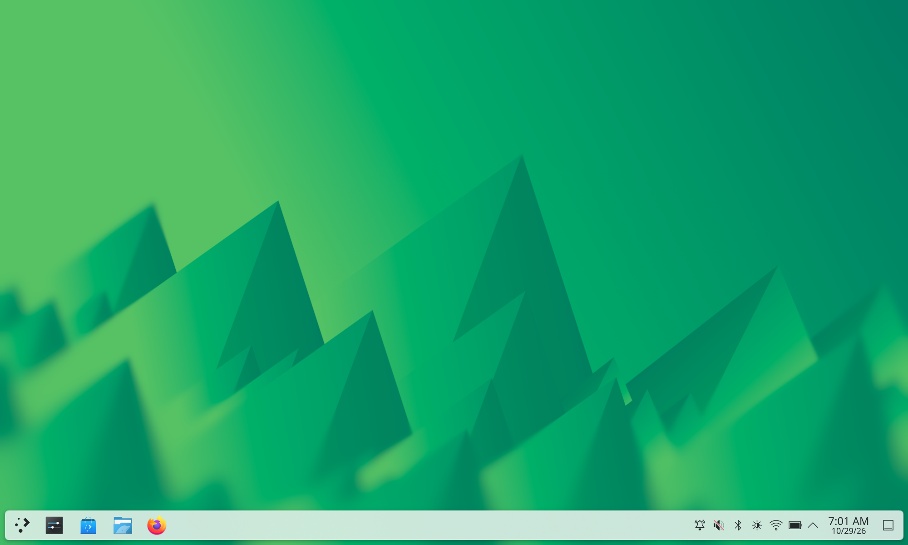
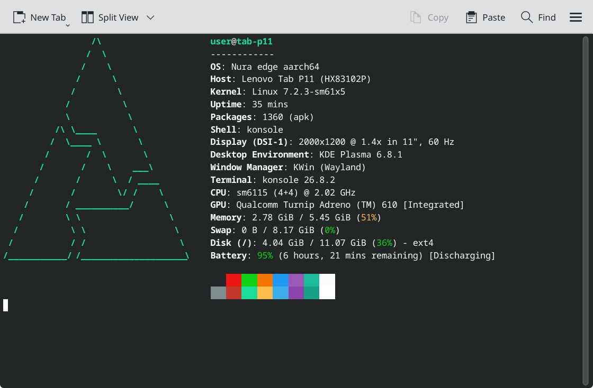
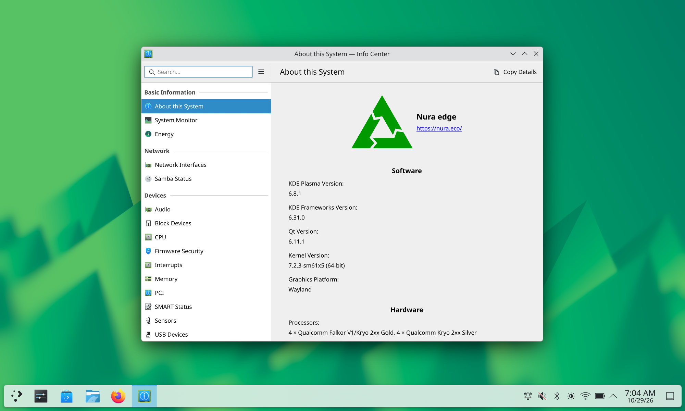

# postmarketOS for the Lenovo Tab P11 (TB-J606F)

A port of [postmarketOS](https://postmarketos.org) (since 2026 the project is called **Nura**) to the
**Lenovo Tab P11 TB-J606F** (Wi-Fi) tablet, based on the **mainline Linux 7.2 kernel**
([linux-nura-qcom-sm61x5](https://codeberg.org/sm61x5-mainline/linux)).

> 🇷🇺 The original Russian documentation is on the [`main`](../../tree/main) branch. This `english` branch is a translation of its Markdown files.

> **Status: pmOS (Nura edge) with KDE Plasma Desktop installs to internal storage and boots on its own.** Working: display, GPU (OpenGL ES and Vulkan),
> Plasma (Wayland), Wi-Fi, **Bluetooth (fully: pairing and input devices)**, USB networking/SSH, buttons, battery and charging status.
> The sensors (light, proximity, accelerometer), the **touchscreen** (a port of the Lenovo GPL driver for HX83102E), **USB OTG** and charging from a USB-C wall charger work,
> as does the **Lenovo Keyboard Pack pogo dock — keyboard and touchpad** (hid-over-i2c 0x60/0x61, kernel r122, thanks to kruzeman for PR #1);
> the GPU is 2.5–7 times faster after fixing the DDR bandwidth vote (patch 0009). **Hardware H.264/HEVC decoding through Venus** works (patch 0011).
> **The speakers work** (4× AW88258, stereo, since kernel r117 + device r17); no microphones or USB-C headset yet.
> **Both cameras work** (rear OV13B10 with manual focus, front S5K4H7 with our own driver; kernel r121 + libcamera r6).
> Suspend is experimental (a CrashDump is possible a couple of minutes after a resume — better turn automatic sleep off), offline charging is in progress.
> **Installation: a ready archive from the [Releases](https://github.com/Yar1klamer/j606f-postmarketos/releases) page and one script** (see [Installation](#installation)).
> Updates are installed through the **apk repository** (see [below](#updates-through-the-apk-repository)). Details are in [STATE.md](STATE.md).

**The author of the port and of the apk repository is [@nnshould](https://t.me/nnshould) (Telegram).** Questions about the repository, installation and help go there.



<details>
<summary>More screenshots</summary>

| fastfetch | System information (KInfoCenter) |
|---|---|
|  |  |

Early bring-up — weston on the mainline kernel (a compositor buffer capture):


</details>

---

## Contents
- [Device](#device)
- [What works](#what-works)
- [The main quirk: the Lenovo bootloader and dtbo](#the-main-quirk-the-lenovo-bootloader-and-dtbo)
- [Repository layout](#repository-layout)
- [Building](#building)
- [Installation](#installation)
- [Updates through the apk repository](#updates-through-the-apk-repository)
- [Rolling back to Android](#rolling-back-to-android)
- [Debug environment without a rootfs](#debug-environment-without-a-rootfs)
- [Known issues and plans](#known-issues-and-plans)
- [Credits and licences](#credits-and-licences)

## Device

| | |
|---|---|
| Model | Lenovo Tab P11, TB-J606F (Wi-Fi, no LTE), 2020 |
| SoC | Qualcomm SM6115P "bengalp" (Snapdragon 662), soc_id 445 |
| CPU | 4× Kryo 260 Gold up to 2.016 GHz + 4× Kryo 260 Silver up to 1.8 GHz |
| GPU | Adreno 610 |
| RAM / storage | 4 or 6 GB / UFS 64 or 128 GB (tested on 6/128) |
| Display | 11", 2000×1200, **two revisions**: BOE + **Himax HX83102P** (the main one, tested) and BOE + Novatek NT36523W (own DTB and device package, not tested) |
| Touch | Himax HX83102E (zero-flash, SPI) + stylus; Novatek on the second revision |
| Wi-Fi / BT | WCN3990 (ath10k_snoc / btqca) |
| Battery | 7500 mAh, MM8013 fuel gauge, PMI632 + SMB1355 charger |
| Audio | 4× Awinic AW88258, ES7210, WCD937x / PM2250 |
| Sensors | through the Qualcomm SSC (ADSP): ICM4x6xx, LTR578, TMF8801, SX932x |

The revision is identified by `/proc/cmdline` of the stock Android:
`msm_drm.dsi_display0=qcom,mdss_dsi_himax83102p_boe_2k_video` means the Himax revision (this port).

## What works

Tested in the installed pmOS (kernel 7.2.3 with patches up to 0024, Plasma Desktop), first through `fastboot boot`. Per-subsystem details are in [`docs/notes/`](docs/notes/).

| Subsystem | Status | Note |
|---|---|---|
| Kernel boot | ✅ | with an erased `dtbo` (or through the "sink" for the stock dtbo, see below) |
| UFS, partitions | ✅ | |
| microSD | ✅ | sdhc_2: the card is detected and mounted, discard works (tested on the second tablet) |
| HX83102P display + backlight | ✅ | own panel driver (init from the stock DT), 60 Hz, DCS brightness 0…4095 |
| Adreno 610 GPU | ✅ | Mesa freedreno (GLES 3.2) and **Vulkan** through turnip (`mesa-vulkan-freedreno`). Patch 0009: the GPU votes for DDR bandwidth (missing in sm6115.dtsi) — glmark2-es2 277 → 694, vkmark 87 → 599 |
| Venus video decoding | ✅ | **Hardware H.264 and HEVC 1080p** through `v4l2m2m-copy` (patch 0011, kernel r115 + per-device firmware r2); full files tested with a clean EOF. For watching in mpv software decoding is smoother (copying frames out of Venus drops frames), see below |
| Video in mpv | ✅ | device r20+ ships `/etc/mpv/mpv.conf`: `profile=fast` (the default scaling cannot keep up at 2000×1200 — without it 50–75% of frames are dropped) and `hwdec=no`. 1080p H.264 30/60 fps — 0/3 drops out of 360/720, HEVC — 0/28 |
| Wayland, KDE Plasma Desktop | ✅ | weston and Plasma (kwin_wayland) on the GPU, 60 Hz; autologin and landscape are set up by hand |
| On-screen keyboard | ✅ | plasma-keyboard (EN/RU), an icon on the panel; see the [notes](docs/notes/input_keyboard.md) |
| Power, Vol± buttons | ✅ | Power turns the screen off/on (a PowerDevil setting) |
| USB networking, SSH | ✅ | ECM/ACM gadget |
| USB OTG (host) | ✅ | Type-C through the FUSB302 + an external 5 V boost (gpio38), patch 0008; USB 2.0, no PD. Tested with a USB mouse receiver. After leaving host mode USB networking to the PC does not work until a reboot (dwc3 "failed to enable ep0out") |
| Charging | ✅ | from USB-A and USB-C (C-to-C) wall chargers, a power bank and a PC USB port; always 5 V (no PD/QC), input up to 1.5 A: ~1.0–1.4 A into the battery from wall chargers, slower from a PC. For C-to-C the FUSB302 sets Rd (patch 0008), without it such chargers do not turn on. A weak charger or cable: the PMI632 lowers the current (AICL), and with the screen on the charge may not be enough |
| Wi-Fi | ✅ | ath10k (WCN3990): WPA2 connection, DHCP, internet |
| Bluetooth | ✅ fully | WCN3990 (btqca): discovery, pairing, HID devices (tested with a mouse); bootmac sets a persistent address |
| Battery | ✅ | mm8013 fuel gauge (patch 0005: correct current sign per the ABI, link to the charger, Li-ion) — Plasma/UPower show charging/discharging correctly |
| cpufreq, thermal, CPU throttling | ✅ | cooling-maps added to the DTS |
| Modem / ADSP / CDSP | ✅ start | stock firmware |
| Reboot to bootloader | ✅ | PON reboot-mode |
| Touchscreen | ✅ | HX83102E (zero-flash, SPI): port of the Lenovo driver (patch 0006), firmware `Himax_firmware.bin` from the tablet's own vendor or the shared set; follows the panel when the screen is turned off |
| Stylus | ❓ | the `himax-pen` device exists, not tested with a pen |
| Speakers | ✅ | 4× AW88258 (own driver, patch 0013) on PRIMARY TDM (0014): stereo, the left pair plays the left channel, the right pair the right one; amplifier volume is limited to −6 dB (the stock speaker protection on the DSP is missing), a battery/temperature monitor as in stock; the amplifier settings `awinic/aw882xx_acf.bin` come from the tablet's own vendor partition. UCM: the "Speaker" device in PulseAudio |
| Microphones, headset | ❌ | ES7210 — needs a driver port; the headset goes through USB-C (WCD937x behind the FSA4480, the codec and SoundWire already come up) |
| Sensors (accelerometer, light, proximity) | ✅ | Qualcomm SSC on the ADSP: hexagonrpcd (own patch, `pmaports/temp/hexagonrpcd`) + libssc + iio-sensor-proxy; since device r22 the SSC files are taken from the tablet's own partitions (dsp, vendor, persist) automatically. The accelerometer mount matrix is not found yet |
| Charge control (PMI632) | ⚠️ read only | own read-only driver (patch 0004): online, status, USB type, limits. Charges on the bootloader settings (4.40 V / 3 A, 1.5 A input): the input limit is not raised for a 3 A charger, no PD/QC, no charge threshold and no parallel SMB1355 |
| Suspend (s2idle) | ⚠️ experimental | r110 fixed USB ep0, r111 — a successful s2idle; on r121 (02.11) suspend and resume run without USB/ADSP errors, sound and BT come back. Since device r21 (nt36523w r11) the suspend helper is packaged: the sensors and BT are stopped before suspend and come back after it (tested 02.11, three cycles). ⚠ 03.11: CrashDump ~2 min after a resume (kernel r121, cause not found yet) — better turn automatic sleep off. Long suspend and suspend with OTG are not tested |
| Offline charging | ⚠️ partial | device r11: charger mode from the PON reason + a reboot mark, a normal reboot is tested; the full poweroff/charger/unplug cycle is not finished yet |
| Rear camera | ✅ | OV13B10 (13 MP) through the SM6115 CAMSS (patches 0017–0021) and libcamera with the GPU software ISP (`pmaports/temp/libcamera`, own patch 0007): auto exposure and white balance, 2104×1560 ~28 fps, 1280×720 ~117 fps; in PipeWire — "ov13b10 [libcamera]". The DW9763 focus (0022) is manual only (`focus_absolute`): the software ISP has no autofocus |
| Front camera | 🟡 | S5K4H7 (8 MP): no mainline driver — own one (patch 0023, registers from the stock CamX module), DT (0024) and a libcamera helper (own patch 0008); 3264×2448 at 30 fps through libcamera. Kernel r121 + libcamera r6 (in the apk repository since 02.11). With strong backlight (a window in the frame) the libcamera auto exposure overexposes the frame — tuning is ahead |
| Pogo-pin keyboard | ✅ | Lenovo Keyboard Pack: keyboard 17ef:6103 and touchpad 04f3:3164 (hid-over-i2c, patch 0025, kernel r122) |

## The main quirk: the Lenovo bootloader and dtbo

This tablet's ABL **always** applies the overlay from the `dtbo` partition (the "Lenovo P11 WIFI PVT" entry) onto the DTB from boot.img.
The mainline DTB has no `__symbols__`, the overlay fails, and ABL answers `Booting OKAY` but does not start the kernel.

**The simple solution (tested): erase the dtbo of the slot pmOS boots from** — `fastboot erase dtbo_b`.
Then ABL takes the DTB from boot.img as is (suggested by a colleague who is also porting pmOS to this tablet). The stock `dtbo_a` is not touched.

A solution without writing to `dtbo` (if erasing is not an option):
[`kernel/dts/sm6115p-lenovo-j606f-abl-sink.dtsi`](kernel/dts/sm6115p-lenovo-j606f-abl-sink.dtsi) adds a disabled `/abl-sink` node
with a phandle node for each label from the `__fixups__` of the stock overlay (138 of them) and `__symbols__` pointing to these nodes.
The overlay lands in the "sink", the kernel ignores it. Generator: [`scripts/gen_abl_sink_dtsi.py`](scripts/gen_abl_sink_dtsi.py).

Side effect: ABL replaces the root `model`/`compatible` with `qcom,bengalp-idp`. Because of that `ubwc_config` and `qcom_pd_mapper`
do not recognise the SoC. The `0002-HACK` patch worked around it (adds `qcom,bengalp`; kept in `kernel/patches/` for this case).
**An erased dtbo_b is used now**, so the kernel package is built **without** HACK 0002, and abl-sink stays in the DTB as a safety net.

One more quirk: `fastboot boot` works **once per bootloader session**. Every attempt needs a `fastboot reboot bootloader` first.

## Repository layout

```
kernel/
  patches/                 patches for linux-nura-qcom-sm61x5 7.2.3 (package linux-lenovo-j606f)
    0001-…-HX83102P.patch   BOE/Himax HX83102P panel in panel-himax-hx83102.c
    0002-HACK-…patch        qcom,bengalp for ubwc_config/pd_mapper (only if dtbo is not erased; not in the package)
    0003-…-HX83102P-SKU.patch  DTS of the HX83102P revision + abl-sink.dtsi + Makefile
    0004-…-PMI632-charger…patch  read-only PMI632 (SMB5) charger driver + DTS node
    0005-…-mm8013-…patch      mm8013: current_now sign, power-supplies → charger, TECHNOLOGY=Li-ion
    0006-…-HX83102E-…patch    Himax HX83102E touchscreen (port of the Lenovo driver) + DTS node
    0007-…-NT36523W-SKU.patch the shared DTS part (common.dtsi) + the DTB of the NT36523W revision
    0008-…-USB-C-OTG…patch     USB-C OTG: FUSB302 (I2C0 0x22) + VBUS boost on gpio38, dwc3 dual-role
    0009-…-GPU-DDR-bandwidth…  GPU DDR bandwidth vote (gfx-mem + opp-peak-kBps from stock)
    0010-…-UTMI…resume.patch  restore the USB UTMI clock after suspend
    0011-…-Venus-video-codec.patch  SM6115 Venus: DTS, vcodec0 HW_CTRL, stock firmware and the EOS quirk
    0012-…-LPASS-devices.patch  SM6115 LPASS: RX/TX/VA macros, SoundWire, LPI pinctrl
    0013-…-AW88258-…patch     Awinic AW88258 amplifier driver (speakers)
    0014-…-primary-TDM-…patch  sm8250: playback on PRIMARY_TDM_RX_0 (4 amplifiers, stereo)
    0015-…-soundwire-…patch   soundwire-qcom: recover from clock stop without devices
    0016-…-j606f-add-audio.patch  J606F audio DTS (audio.dtsi)
    0017-…-camss-…SM6115…patch  CAMSS for SM6115 (Spectra 340: 3× CSIPHY/CSID/TFE)
    0018-…-ov13b10-…OF-match… ov13b10: OF table (the driver was ACPI only)
    0019-…-sm6115-add-CCI-and-CAMSS.patch  CCI and CAMSS nodes in sm6115.dtsi
    0020-…-j606f-add-cameras.patch  J606F camera DTS (camera.dtsi): GPIO-switched supplies, OV13B10 + DW9763, S5K4H7 (disabled)
    0021-…-ov13b10-add-get_selection.patch  ov13b10: array size and per-mode crop for libcamera
    0022-…-dw9719-add-DW9763.patch  dw9719: DW9763 VCM (ID 0xf9)
    0023-…-add-Samsung-S5K4H7-sensor-driver.patch  S5K4H7 front sensor driver + binding
    0024-…-j606f-enable-front-camera.patch  DTS: S5K4H7 front camera on CSIPHY2 (4 lanes, 366 MHz), MCLK2 24 MHz
    config-j606f.fragment   kernel options (HX83102, TPS65132, MM8013, NT36523, CHARGER_QCOM_PMI632, TOUCHSCREEN_HIMAX_HX83102E, TYPEC_FUSB302)
  himax83102p-port/         how 0006 was made: port.py (Lenovo sources → 7.2), make_patch.sh, Kconfig/Makefile
  dts/                     the same DTS as separate files
pmaports/device/testing/
  linux-lenovo-j606f/      kernel package: linux-nura-qcom-sm61x5 7.2.3 + patches 0001, 0003–0025 (pkgrel 122); its own name so that the upstream package does not replace it
  device-lenovo-j606f-nt36523w/  device package of the NT36523W revision (not tested)
  device-lenovo-j606f/     device package (deviceinfo: rootfs → userdata, automatic boot_b write on update; modules-initfs, GPU firmware in the initramfs, bootmac)
  firmware-lenovo-j606f/   firmware package (APKBUILD — own tarball; APKBUILD.shared — the shared S320208 set from the apk repository)
pmaports/temp/hexagonrpcd/ hexagonrpcd 0.4.0-r50 with a patch: serves the sns_reg_version file to the ADSP (needed for the SSC sensors)
pmaports/temp/libcamera/  libcamera 0.7.2 (pmOS) r6 + patches 0007–0008: helpers and properties of the OV13B10 and S5K4H7 sensors (gain, black level) for auto exposure
scripts/                   tools: boot.img/dtbo/super inspection, backup, debug initramfs,
                           building on the tablet itself, a proxy for USB networking, installation
STATE.md                   ← START HERE: current state, versions, next step
DEVICE.md                  everything about the tablet: hardware, partitions, boot modes, status
docs/
  DECISIONS.md             decisions taken and why (in detail)
  COMMANDS.md              tested commands
  notes/                   per-subsystem notes (display, touch, wifi_bt, power, audio, sensors, boot …)
```

> **What is not here and never will be:** partition dumps, Lenovo firmware, serial numbers, MAC addresses, keys and passwords.
> The firmware comes from **your** device or from the shared stock set in the apk repository (see below), but not from git.

## Building

### 1. Firmware
The easiest is to do nothing: since **device r23** the image needs no Lenovo blobs at all — on the first boot `j606f-firmware-extract` takes
**everything** from the tablet's own partitions (modem, bluetooth, dsp, vendor from super, persist: DSP, Wi-Fi/BT, GPU zap, Himax touch, speaker acf, sensor files)
and reboots once. `device-lenovo-j606f-nonfree-firmware` no longer pulls `firmware-lenovo-j606f`.
If vendor on the tablet is wiped, install the **shared stock S320208 set** (Android 11, version `0.320208`) from the [apk repository](#updates-through-the-apk-repository):
`sudo apk add firmware-lenovo-j606f`. Your own backup is only needed if you want fully your own firmware. A package built from it (`pkgver 1`) always takes precedence over the shared set.

#### Your own backup
Needs root (Magisk) in the stock Android:
```bash
bash scripts/phase0_root.sh                 # collect information
bash scripts/backup_partitions.sh           # full backup, sha256 verified
bash scripts/collect_firmware.sh            # take the firmware → FIRMWARE/<date>/*.tar and build the tarball right away
```
`collect_firmware.sh` (read only) takes `/vendor/firmware_mnt`, `/vendor/firmware`, `/vendor/bt_firmware` and the sensor files,
then [`scripts/build_firmware_package.sh`](scripts/build_firmware_package.sh) joins `.mdt` + `.bNN` → `.mbn`
([`pil_squash.py`](scripts/pil_squash.py)) and writes `FIRMWARE/<date>/firmware-lenovo-j606f-1.tar`, checking the contents:
`qcom/sm6115/LENOVO/J606F/{a610_zap,adsp,cdsp,modem,venus,wlanmdsp}.mbn`, `qca/{crbtfw21.tlv,crnv21.bin}`,
`Himax_firmware.bin` and `Himax_mpfw.bin` (touch). Archives taken earlier can be packed separately:
`bash scripts/build_firmware_package.sh FIRMWARE/<date>`. `venus.mbn` is needed for hardware video (kernel r115+).

Firmware differs between tablets — install only the tarball from **your own** device and do not publish it.

#### Firmware from the tablet itself
It is taken by `/usr/lib/j606f/firmware-extract` from device-lenovo-j606f (r12+; the current scheme since r16). It runs when the
device package is installed and updated, from an apk trigger on any change of the firmware package, and on every boot. The partitions are mounted
read only, nothing is written to them:
- `modem_a/b` (NON-HLOS, left over from stock): `adsp`, `cdsp`, `modem`, `venus` (`.mdt` + `.bNN` → `.mbn` through `pil-squasher`), `wlanmdsp`;
- `bluetooth_a/b`: `qca/crbtfw21.tlv`, `qca/crnv21.bin`;
- `vendor_a/b` inside super (`make-dynpart-mappings`, ext4 `ro,noload`): GPU `a610_zap`, touch `Himax_*.bin` and the speaker amplifier settings
  `awinic/aw882xx_acf.bin` (r17+; without it the sound card waits for the file and comes up as soon as it appears).

If the shared set is installed (marker `/usr/share/j606f/firmware-shared`), the files from `modem` and `bluetooth` go to `/lib/firmware/updates`.
The kernel and tqftpserv look there first, so the DSPs run on the firmware of the tablet's own stock. This matters: with an ADSP from another Android version
the sensors crash. Tested on a tablet with stock Android 10 (S120184) and the S320208 set installed: its own
ADSP/CDSP/WLAN/Venus were loaded, the sensors work. The GPU and touch files from vendor go to `/lib/firmware` only if no package has them:
the versions from the set work on both stocks. With a personal package (`pkgver 1`) the copies in `updates` are removed and the package is used as is.

Super is not touched when installing to userdata. If it was overwritten (early installs of this port), the GPU and touch files come from the package.
What was taken from the tablet is recorded in `/var/lib/j606f/firmware-extract.list`.

A fresh image: on the first boot the DSPs start with the shared set, and the tablet's own firmware is copied to `updates` along the way.
So reboot the tablet once more after the first boot (the journal says: `running DSPs use the new firmware after the next reboot`).

### 2. pmaports
```bash
git clone https://gitlab.postmarketos.org/postmarketOS/pmaports.git
cp -r pmaports/device/testing/device-lenovo-j606f    <pmaports>/device/testing/
cp -r pmaports/device/testing/firmware-lenovo-j606f  <pmaports>/device/testing/
cp -r pmaports/device/testing/linux-lenovo-j606f    <pmaports>/device/testing/   # kernel 7.2.3 + patches 0001, 0003–0025
cp -r pmaports/temp/hexagonrpcd                      <pmaports>/temp/              # for the sensors (see docs/notes/sensors.md)
cp -r pmaports/temp/libcamera                        <pmaports>/temp/              # for the cameras (see docs/notes/camera.md)
# firmware: either your own tarball
cp firmware-lenovo-j606f-1.tar <pmaports>/device/testing/firmware-lenovo-j606f/
pmbootstrap checksum firmware-lenovo-j606f   # everyone has their own tarball
# or the shared S320208 set (the tarball is downloaded from https://repo.yarnick.ru/j606f/distfiles/, sha512 in the APKBUILD)
cp <pmaports>/device/testing/firmware-lenovo-j606f/APKBUILD.shared <pmaports>/device/testing/firmware-lenovo-j606f/APKBUILD
```
> The kernel package here (`linux-lenovo-j606f`) is the upstream `linux-nura-qcom-sm61x5` 7.2.3 with the patches from [`kernel/patches/`](kernel/patches/) and the options
> from `config-j606f.fragment` added. The first install was done differently: the binary 7.2.3-r0 kernel + modules/DTB built separately
> ([`scripts/device_build_inner.sh`](scripts/device_build_inner.sh));
that path is no longer used.

### 3. pmbootstrap
```bash
pmbootstrap init         # device: lenovo-j606f
pmbootstrap install
pmbootstrap export
```
Tested on x86_64 Ubuntu 22.04 (the kernel is built cross-native) and **on the tablet itself** (aarch64, under mainline, in a chroot on userdata,
[`scripts/device_pmb_env.sh`](scripts/device_pmb_env.sh)). If the mirror is slow, the caching proxy
[`scripts/mirror_proxy.py`](scripts/mirror_proxy.py) on a nearby computer helps.

## Installation

> **The revision with the Novatek NT36523W panel** (`dsi_display0=…nt36523w…`): a separate device `lenovo-j606f-nt36523w`,
> instructions — [`docs/notes/install_nt36523w.md`](docs/notes/install_nt36523w.md) (not yet tested on hardware, no touch).

### The ready archive (recommended)

Download **`j606f-pmos-hx83102p-<date>.zip`** from the [Releases](https://github.com/Yar1klamer/j606f-postmarketos/releases) page — the image is already built
and is flashed by one script. Only for the **TB-J606F with the HX83102P panel** (`dsi_display0=…hx83102p…`), an **unlocked bootloader** is required.
**userdata is erased completely** (the Android data is lost).

1. Unpack the whole archive into one folder.
2. Power the tablet off, hold **Volume− + Power** → fastboot, connect it to the computer (fastboot from the Android platform-tools is needed).
3. Run **`flash-all.bat`** (Windows; fastboot.exe next to it or in PATH) or **`./flash-all.sh`** (macOS / Linux; `FASTBOOT=/path/to/fastboot` if needed).
4. The script checks the sha256 of the files, that this is a `bengal` with an unlocked bootloader, asks for `YES` and runs:
   `flash userdata userdata.img`, `flash boot_b boot.img`, `erase dtbo_b`, `--set-active=b`, `reboot`. Slot a and the other partitions are not touched.
5. **First boot:** the archive has no Lenovo firmware — `j606f-firmware-extract` reads it from the tablet's own partitions
   (modem, bluetooth, dsp, vendor from super, persist), rebuilds the initramfs and **reboots once**. Login **user / 147147** → `passwd` right away.
   The sensors show up about 2 minutes after boot.

Tested 03.11 on our tablet with the stock super: the firmware is extracted, GPU, touch, speakers, BT, Wi-Fi and sensors work.
`flash-all.bat` was not tested on Windows. If vendor on the tablet is wiped (a GSI replaced super), the GPU/touch/speakers find no firmware —
install the shared set: `sudo apk add firmware-lenovo-j606f` (needs a network) and reboot. sshd is off in the image and `sudo` asks for the password.

### Manual installation (from your own build)

Same layout: **rootfs in userdata** (~100 GiB), boot.img in **boot_b**, dtbo_b erased, slot a untouched.
```bash
fastboot flash userdata lenovo-j606f.img   # rootfs (pmOS_boot + pmOS_root), sparse image: fastboot only, not dd!
fastboot boot boot.img                     # test the kernel without writing (fastboot boot — once per bootloader session)
# if it booted: back to fastboot (reboot bootloader from Linux or Vol− + Power), then
fastboot flash boot_b boot.img             # userdata and boot_b must come from the same pmbootstrap install (UUID)
fastboot erase dtbo_b                      # ABL stops applying the stock overlay
fastboot --set-active=b && fastboot reboot
```
With device package r6, `pmbootstrap flasher flash_rootfs` writes to userdata by itself (`deviceinfo_flash_fastboot_partition_rootfs="userdata"`).
An image without Lenovo blobs, like the archive — [`docs/COMMANDS.md`](docs/COMMANDS.md) ("Flashable image"), the archive scripts — [`release/`](release/).
- **Do not keep a pmOS layout in two partitions at once.** The initramfs takes the first partition with two subpartitions in the order of
  `/proc/diskstats`, and super (sda14) comes before userdata (sda15). On a clean device super holds the Android partitions, which is fine.
  If you installed pmOS into super earlier, remove the GPT there ([install_plan](docs/notes/install_plan.md)) or flash the stock super.

In detail, with rollback: [`docs/notes/install_plan.md`](docs/notes/install_plan.md).
[`scripts/device_install_pmos.sh`](scripts/device_install_pmos.sh) — the old script for installing into **super** from a running mainline (history).

## Updates through the apk repository

The built packages of the port (kernel, device packages, hexagonrpcd) are in the signed apk repository
**https://repo.yarnick.ru/j606f** (key `pmos@local-6ae27901`). The repository is run by [@nnshould](https://t.me/nnshould) (Telegram) — ask questions about it there.
It also holds the shared firmware set of the S320208 stock: `firmware-lenovo-j606f-0.320208` (Android 11; the source tarball is in `j606f/distfiles/`).
It is for those who have no backup of their own. A personal build (`1-rN`) is always newer, apk will not replace it.

**Since device-lenovo-j606f r18 nothing needs to be configured:** the device package installs the repository address
(`/usr/lib/apk/repositories.d/j606f.list`) and its key (`/usr/lib/apk/keys/`), and apk 3 reads them alongside `/etc/apk`.
An image built from this pmaports updates with a plain `apk upgrade` from the first boot.
The `@j606f` tag is no longer needed: the port's kernel is called `linux-lenovo-j606f`, and no package from the regular repositories replaces it.

Migration for installs with device ≤ r17 (once; you already have the key from earlier instructions, otherwise — the first line):
```bash
[ -f /etc/apk/keys/pmos@local-6ae27901.rsa.pub ] || sudo wget -O /etc/apk/keys/pmos@local-6ae27901.rsa.pub https://repo.yarnick.ru/pmos@local-6ae27901.rsa.pub
echo "https://repo.yarnick.ru/j606f" | sudo tee -a /etc/apk/repositories
sudo apk update
sudo apk add linux-lenovo-j606f device-lenovo-j606f device-lenovo-j606f-nonfree-firmware
sudo /usr/lib/j606f/repo-migrate
sudo reboot
```
`repo-migrate` removes the old `@j606f …` line from `/etc/apk/repositories` (and the temporary line above: the address is now in the device package),
and from `/etc/apk/world` — `linux-nura-qcom-sm61x5`, the `@j606f` tags and the version pins of the port's packages; then `apk upgrade`
removes the old kernel package (its files already belong to `linux-lenovo-j606f`). Copies of the original files — `*.before-j606f-<time>` next to them.
The **NT36523W** revision: instead of `device-lenovo-j606f` and its `-nonfree-firmware` — `device-lenovo-j606f-nt36523w device-lenovo-j606f-nt36523w-nonfree-firmware`
(the device packages of the two revisions cannot be installed together, see [install_nt36523w](docs/notes/install_nt36523w.md)).
Since device r22 `hexagonrpcd` and the drop-ins with `-R` come with the device package (the services start only once the SSC files are extracted, see [sensors](docs/notes/sensors.md)).
`hexagonrpcd` kept the upstream name: our build 0.4.0-r50 (the `sns_reg_version` patch) is higher than Alpine 0.4.0-r3, but if Alpine releases 0.4.1,
apk installs it and the patch is gone (the sensors break, not the boot) — until the patch is accepted into hexagonrpc, check the sensors after such an update.

Updating:
```bash
sudo apk update && sudo apk upgrade && sudo reboot
```
When moving to **device r23+** from an install where the firmware came from the `firmware-lenovo-j606f` package: if it is not in `/etc/apk/world`, apk removes it.
A tablet with the stock vendor just extracts the files again (up to two reboots); if vendor is wiped — run `sudo apk add firmware-lenovo-j606f` beforehand.
Since **device-lenovo-j606f r16** the DSP firmware of your own stock (including `venus.mbn` for video) is taken from the tablet's own partitions and
comes before the shared set, see [Firmware](#1-firmware). If the shared set is installed by the same update, one reboot is enough.
Since **device-lenovo-j606f r7** `deviceinfo_flash_kernel_on_update` is enabled: after a kernel or initramfs update boot-deploy itself writes
`boot.img` to `boot` + the current slot suffix (`boot_b`) — the apk output shows `Flashing boot.img to 'boot_b'`. A manual `dd` is no longer needed
(on device ≤ r6 it is: `sudo dd if=/boot/boot.img of=/dev/disk/by-partlabel/boot_b bs=4M conv=fsync`).
If the new kernel does not boot or power was lost during the write — in fastboot (Vol− + Power) `fastboot flash boot_b <previous boot.img>`;
before a kernel update it is handy to save a copy: `sudo head -c $(stat -c %s /boot/boot.img) /dev/disk/by-partlabel/boot_b > ~/boot_b-backup.img`.
Check after the reboot: `uname -v` shows `#<pkgrel+1>-nura-qcom-sm61x5` (for example, r118 → `#119`), `apk list -I | grep -E 'device-lenovo|linux-lenovo'` — device r24 and linux-lenovo-j606f r121 or newer.
Sound: `pactl list short sinks` shows `alsa_output.platform-sound.HiFi__Speaker__sink`.
The repository receives the port's packages and exactly one firmware package — the shared S320208 set, verified by sha256 at publication.
Any other firmware, including personal builds from backups, and everything with `license = proprietary` is filtered out.

## Rolling back to Android
- Make a full backup before any write ([`scripts/backup_partitions.sh`](scripts/backup_partitions.sh)).
- `fastboot --set-active=a` returns booting from slot a, if it was not touched.
- Full rollback: EDL + [qdl](https://github.com/linux-msm/qdl) and the stock Lenovo firmware (see the postmarketOS wiki for this device).

## Debug environment without a rootfs

For bring-up without installing: [`scripts/make_debug_bootimg.py`](scripts/make_debug_bootimg.py) builds a boot.img
(header v2) from a ready kernel, DTB and a small busybox initramfs:
- USB gadget ECM (network) + ACM (`/dev/cu.usbmodem*` on macOS), link-local address 169.254.42.1;
- nc shell on port 9100 ([`scripts/tcp_run.sh`](scripts/tcp_run.sh)), ACM shell ([`scripts/acm_run.py`](scripts/acm_run.py));
- a safety `reboot -f` after 300 s without contact with the host;
- `scripts/cycle_boot.sh`: reboot → bootloader → `fastboot boot` → wait for the network.

## Known issues and plans
- **Touch:** works (port of the Lenovo driver from [adazem009/kernel_lenovo_tbj606](https://github.com/adazem009/kernel_lenovo_tbj606), patch 0006). The pen is not tested. [Notes](docs/notes/touch.md).
- **Sound:** the speakers work (r117). Next — the ES7210 microphones (port of the Lenovo driver) and the analogue headset over USB-C (FSA4480). The stock speaker protection (an algorithm on the ADSP) does not exist in mainline, so the amplifier volume is limited. Occasionally after boot the ADSP does not come up fully and there is no sound card — a reboot helps. [Notes](docs/notes/audio.md).
- **Sensors:** work out of the box (since device r22 the SSC files come from the tablet's partitions); what is left is to find the `ACCEL_MOUNT_MATRIX` for auto-rotation. [Notes](docs/notes/sensors.md).
- **Storage:** the pmOS root is in userdata (~100 GiB), see [install_plan](docs/notes/install_plan.md).
- **Charger:** charges, but the driver is read only. Next — the input limit by Type-C/APSD (now 1.5 A even from a 3 A charger), the charge threshold, JEITA; fast charging (PD/QC, the parallel SMB1355) is a separate big job. [Notes](docs/notes/power.md).
- **Suspend:** r110/r111 + the suspend helper from device r21 give s2idle with the sensors coming back, but **a CrashDump is possible a couple of minutes after a resume** (an SoC hang, kernel r121; looking for the cause) — better turn automatic sleep off for now. After suspend the USB network may not come back (a reboot is needed). [Notes](docs/notes/suspend.md). **Offline charging:** device r11 implements the charger mode, the final unplug/poweroff testing is left.
- **Venus:** hardware H.264/HEVC decoding works (0011/r115), but in mpv `hwdec=v4l2m2m-copy` drops frames on output (1080p30 ~180 of 360, 1080p60 ~550 of 720) — the expensive copy of frames back; zero-copy (`v4l2m2m`) mpv does not bring up here. VA-API/Firefox and the encoder are not tested yet.
- **Vulkan and vsync:** Vulkan applications in FIFO (vsync) mode get 48 fps instead of 60 (every 5th vblank is skipped; Mesa 26.2 + KWin 6.8, the wp_fifo_v1 protocol); OpenGL gets an honest 60. The cause is not found yet.
- **Cameras:** the rear one works (r120+ + libcamera r5+), focus is manual for now; next — autofocus, colour tuning (ov13b10.yaml), the PMI632 flash. The S5K4H7 front one: our own driver works (kernel r121 + libcamera r6); next — the 2x2 binning mode, s5k4h7.yaml tuning and AGC with backlight; the CSID1/TFE1 path in CAMSS hangs the tablet — not used. Kernel r121 and libcamera r6 are in the apk repository (02.11). [Notes](docs/notes/camera.md).
- **Wi-Fi and your own firmware package:** wlanmdsp.mbn in the package must match `image/wlanmdsp.mbn` of the modem_a partition. Otherwise the modem restarts every ~40 s
  ("User-PD grace timer expired for wlan_process") and there is no wlan0; the stock file in `/lib/firmware/updates/qcom/sm6115/LENOVO/J606F/` fixes it. [Notes](docs/notes/firmware.md).
- **UEFI and Windows on ARM:** explored separately ([Project Aloha mu_aloha_platforms](https://github.com/Project-Aloha/mu_aloha_platforms/releases)).
- The Hall sensor, the vibration motor/LED, the factory MACs from persist (bootmac currently generates stable ones from serialno).
- **Default settings** (autologin, landscape, the Power button, the on-screen keyboard) are still made by hand on the tablet, not moved into packages (STATE.md §2); the hexagonrpcd drop-ins are packaged since r22.
- **Mirrors:** if mirror.nura.eco is slow, set others (these are fast for us from Russia):
  ```bash
  pmbootstrap config mirrors.alpine   http://mirror.yandex.ru/mirrors/alpine/
  pmbootstrap config mirrors.pmaports https://mirror.minlexx.ru/postmarketos/
  pmbootstrap config mirrors.systemd  https://mirror.minlexx.ru/postmarketos/extra-repos/systemd/
  ```
  The official list: https://nura.eco/mirrors/ (for example, RWTH Aachen). Git mirrors: `newgit.minlexx.ru/alexeymin/{pmaports,pmbootstrap}-mirror`.
- Upstream: the DTS of the HX83102P revision and the panel → LKML; the packages → pmaports (taking into account the
  [postmarketOS AI policy](https://docs.postmarketos.org/policies-and-processes/development/ai-policy.html)).

## Credits and licences
- Author of the port, the builds and the apk repository: [@nnshould](https://t.me/nnshould) (Telegram, GitHub Yar1klamer).
- Mainline support for SM6115 and the original DTS `sm6115p-lenovo-j606f.dts`: Linaro, Konrad Dybcio and the linux-msm community.
- The `linux-nura-qcom-sm61x5` kernel: [sm61x5-mainline](https://codeberg.org/sm61x5-mainline/linux), Barnabás Czémán.
- The `panel-himax-hx83102` driver: Cong Yang et al.; postmarketOS/Nura, pmbootstrap, Mesa freedreno.
- For help with testing and finding bugs in the port — @dogotrigger (Telegram)
- Pogo dock (Lenovo Keyboard Pack keyboard and touchpad): Maksim Kruzeman ([@kruzeman](https://github.com/kruzeman), PR #1).

Licences:
- kernel patches and DTS: **GPL-2.0** (DTS: GPL-2.0+ OR BSD-3-Clause, as in the sources);
- scripts and documentation of this repository: **MIT** ([LICENSE](LICENSE));
- the Lenovo/Qualcomm firmware is proprietary and **not part of the git repository**; the shared S320208 stock set is distributed only
  by the apk repository as stock images (only `.mdt` + `.bNN` joined into `.mbn`).

> ⚠️ You do everything at your own risk. Unlocking the bootloader and flashing can lead to data loss
> or a non-working device. Never touch `modem*`, `persist`, `fsg`, `xbl`, `abl` without a backup.
